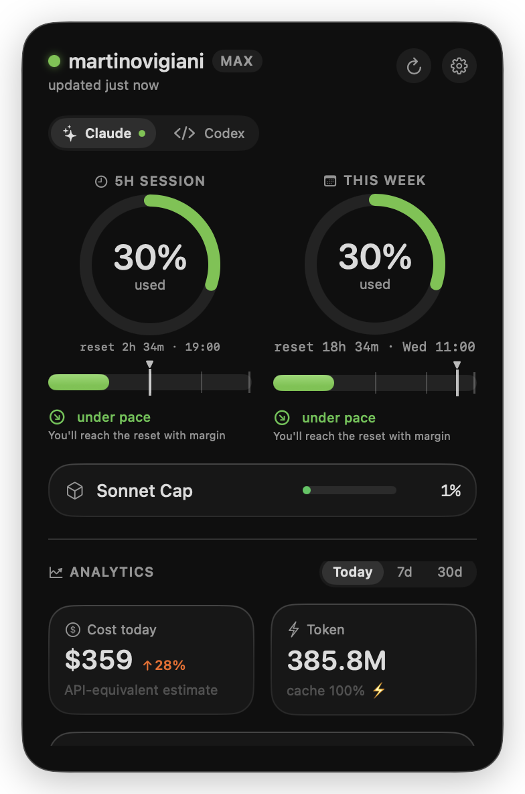

# ClaudeBar

ClaudeBar shows AI coding usage and account limits in the Mac menu bar.

It is for people who use coding assistants and want to see how much of their allowance remains, when it resets, and what their local Claude Code activity looks like.



## What it shows

- A menu bar indicator for the selected provider's usage.
- Usage windows, reset times, and a projection based on the current pace.
- Token counts, model and project breakdowns, and estimated API-equivalent costs from local Claude Code transcripts.
- Connections for Claude, Codex, Gemini, Cursor, and the Anthropic and OpenAI usage APIs.
- English and Italian interface text.

Available information depends on the selected provider, account, and credentials. Local cost estimates are not the amount billed for a subscription.

## Current state

This is a native Mac app built from a Swift package. It includes an app, a separate command-line inspection tool, and tests. Provider access needs real account credentials and can stop working when a provider changes its endpoints or authentication.

The app lives in the menu bar and has no Dock icon. The build scripts create an app bundle and a disk image; they do not notarize them.

## Build and run

You need macOS 26 or later and Xcode with Swift 6.2 and the macOS 26 SDK or later. For the default Claude connection, sign in to Claude Code first.

```sh
git clone https://github.com/martino-vigiani/ClaudeBar.git
cd ClaudeBar
Scripts/bundle.sh
open ./ClaudeBar.app
```

`bundle.sh` builds the app and creates `ClaudeBar.app` in this directory. It may use a local signing certificate if one is available. macOS may ask for Keychain access when you connect a provider.

Click the menu bar icon to open the panel. Use Settings to choose a provider and supply any credentials that provider requires. Packaged builds, when available, are listed under [Releases](https://github.com/martino-vigiani/ClaudeBar/releases).

## Data and credentials

Transcript analytics are computed on the Mac. Usage and authentication requests go to the selected provider. App-managed secrets are stored in the macOS Keychain.

ClaudeBar can read Claude Code's shared credentials. An explicit **Reconnect** action can also refresh them and write the updated credentials back to the Keychain. See [development notes](docs/DEVELOPMENT.md) for the authentication behavior.

## Development and license

- [Development setup, checks, and packaging](docs/DEVELOPMENT.md)
- [Source code](Sources/)

Source is available under [PolyForm Noncommercial 1.0.0](LICENSE). See that file for the permitted uses and restrictions.

Parser and cost-calculation design were inspired by [CodexBar](https://github.com/steipete/CodexBar), by Peter Steinberger. Provider glyphs are derived from [Simple Icons](https://simpleicons.org). Provider names and logos identify their respective products. ClaudeBar is not affiliated with Anthropic or the other providers.
